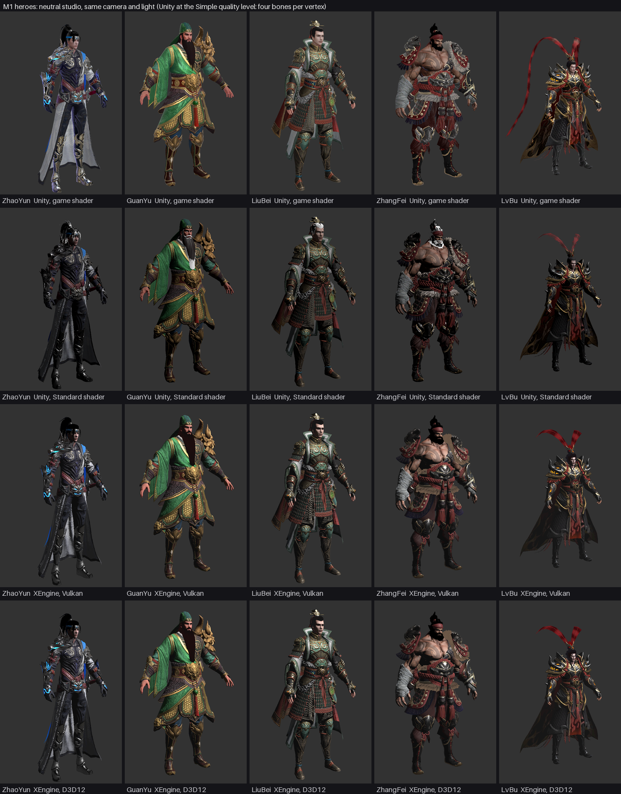
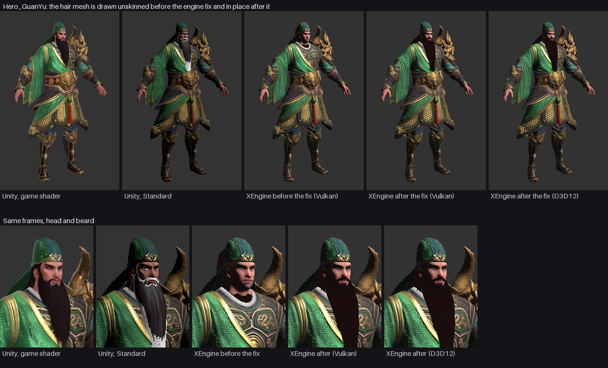

# M1 — 角色模型与 PBR 材质（验收）

- 日期：2026-11-26
- 结论：**通过。** 五个角色的模型、材质、蒙皮在中性光照台下与 Unity 一致；过程中发现并修复了一个引擎缺陷
  （内置着色器不做 GPU 蒙皮，引擎 `fcf643108`）。与本里程碑无关的差异都记在下面的「已知差异」里。
- 引擎版本：1.1.0-a19，含引擎 `main` 的 `cfab4988a`（NuGet 依赖解析）与 `fcf643108`（内置着色器蒙皮）。



## 运行方式

```powershell
# Unity 侧（jws2 的编辑器打开 F:\jws2\client 并空闲）
py -3 Tools/unity_export/run_export.py run export_heroes --out Export/heroes
py -3 Tools/unity_export/run_export.py run capture_heroes --out Export/unity-refs/heroes
py -3 Tools/unity_export/run_export.py run capture_heroes_standard --out Export/unity-refs/heroes-standard
py -3 Tools/unity_export/run_export.py run export_skin capture_silhouettes --out Export/heroes/skin   # 见下，两个目录
# 引擎侧
py -3 Tools/sanguo_import/import_heroes.py
py -3 Tools/xengine_live/mcp_live.py --wait-compile 300 --eval-file Tools/xengine_live/evals/generate_heroes.cs
XEngine.Editor.exe --refresh-assets --project <root>             # 导入生成的 .mat / .prefab
py -3 Tools/xengine_live/mcp_live.py --wait-compile 300 --eval-file Tools/xengine_live/evals/capture_heroes.cs
py -3 Tools/sanguo_import/compare_models.py <inspect_models 的 --out 文件>
py -3 Tools/sanguo_import/compare_skin.py --silhouettes
py -3 -m pytest Tools -q ; dotnet test SanGuoXEngine.Tests.csproj
```

`export_skin` 写到 `Export/heroes/skin`，`capture_silhouettes` 写到 `Export/unity-refs/silhouettes`，两个脚本的输出目录
不同，要分两次运行（上面的命令行只是把它们列在一起）。

## 导入结果

| 项 | 数量 | 说明 |
|---|---|---|
| 模型 | 5 个 FBX，5.7 MB | 原文件拷贝；`.meta` 为 Generic 骨骼、`stripBones`、4 骨 |
| 贴图 | 78 张源贴图（71.9 MB TGA）→ 109 张 PNG（37.3 MB） | 78 张原样转 PNG；31 张派生：`_SFX`（表面图重排）与 `_EMI`（自发光）；6 张引擎用不到的贴图没有导入 |
| 材质 | 26 | 21 个 `Default/Standard`（源 `S_Standard_Hero` ×15、`S_Standard_Skin` ×6），5 个 `Default/StandardAnisotropic`（源 `S_Standard_Hair`） |
| prefab | 5 | 每个 SkinnedMeshRenderer 绑定网格、材质、骨骼，外加带 Avatar 的 `Animator` |

### 贴图通道换算

jws2 的 `_M_Alpha` 打包与代码注释写的不一样，以 `RayPbrShader.cginc` 的
`CustomedHeroMetallicSetup` 为准：**R 金属度、G 环境光遮蔽、B 自发光遮罩、A 光滑度**。

| 引擎属性 | 来源 |
|---|---|
| `_MainTex` | `_MainTex`，原样 |
| `_NormalTex` | `_BumpMap`，原样 |
| `_SurfaceTex` | R = 1 − G（引擎的 R 是遮蔽量）、G = 1 − A（感知粗糙度）、B = R（金属度） |
| `_EmissionTex` / `_EmissionIntensity` | 遮罩 × 线性 `_EmissionColor` × `_EmissionScale`，脉冲取均值，折成「峰值归一的颜色图 × 强度」 |
| `_AlphaCutoff` | `_Cutoff`（头发 0.9–0.95） |

`texture_math.py` 的换算函数各有单元测试（`Tools/sanguo_import/tests/test_texture_math.py`）。

## 模型一致性

`compare_models.py`：两侧的节点集合完全相同，位置与缩放的差在 FBX 的浮点精度内。

| 角色 | 节点（Unity / 引擎） | 只在一侧 | 最大位置差 | 最大局部缩放差 |
|---|---|---|---|---|
| ZhaoYun | 153 / 153 | 0 | 0.01 mm | 0.000005 |
| GuanYu | 106 / 106 | 0 | 4.5 mm（发梢辅助骨） | 0.000048 |
| LiuBei | 149 / 149 | 0 | 0.01 mm | 0.000002 |
| ZhangFei | 121 / 121 | 0 | 0.01 mm | 0.000041 |
| LvBu | 168 / 168 | 0 | 0.01 mm | 0.000025 |

引擎会去掉没有被任何顶点引用的骨骼条目（`stripBones`），所以个别渲染器的骨骼数比 Unity 少；三角形数两侧相同。
明细：[`model-parity.json`](model-parity.json)。

## 蒙皮

这一节的结果颠覆了最初的两个假设，所以把判定过程也记下来。工具是 `compare_skin.py`（数据 + 渲染剪影）与
`fbx_skin_weights.py`（直接读 FBX 文件里写的权重），明细在 [`skin/compare-skin.txt`](skin/compare-skin.txt)。

| 检查 | 结果（27 个蒙皮网格） |
|---|---|
| 原始顶点集合（两侧按位置配对） | 最大差 0.00 mm |
| 骨骼的蒙皮矩阵（`worldToLocal · boneWorld · bindpose`） | 两侧相同，差 < 1e-6 |
| 引擎 CPU 蒙皮 vs Unity 公式（各用自己的权重） | 最大 1.86 mm（GuanYu 头发），其余 ≤ 1.15 mm |
| FBX 里的权重 vs 引擎里的权重 | 26 个网格 ≥ 98.9% 的控制点完全相同；最低 LvBu Face 98.0%。**引擎原样读取 FBX** |
| Unity 渲染的剪影 vs 引擎渲染的剪影 | 重合度 0.997–1.000；Vulkan 与 D3D12 之间 1.000 |
| 两种权重读法（公式混合 / 只取第一骨） | 能区分开的三个头发网格上，**两个引擎画的都是公式混合** |

追查中确认的三件事：

1. **Unity 的活动质量等级是 “Fastest”，`skinWeights = OneBone`**——渲染器和 `BakeMesh` 都只按第一根骨头蒙皮。
   `BakeMesh` 的结果与「只取第一骨」逐顶点重合（偏差 0.0 mm），与「公式混合」相差最多 59.6 mm。
   jws2 的其余等级：Fast = TwoBones，Simple / Good / Beautiful / Fantastic = FourBones。
   引擎按 4 骨混合，所以 **Unity 参考图统一在 Simple 等级（FourBones）下抓取**，抓完恢复原等级；对比前三个头发
   网格的重合度因此从 0.982–0.988 升到 0.997–1.000（见 [`skin/hair-silhouettes.png`](skin/hair-silhouettes.png)
   最右一列）。
2. **Unity 导入时改了权重。** 关羽、刘备、吕布、赵云的 FBX 是「网格压缩 = Low」，导入后 100% 的权重落在 1/31
   的网格上（文件里写的是 0.5 / 0.5，Unity 里是 15/31 / 16/31）；张飞是「Off」，权重与文件、引擎一致。
   这就是「Unity 与引擎权重不同的顶点」一列的来源，影响即上面的 1.86 mm。
3. 引擎的 CPU 数据一开始是对的，画出来却不对——是下面这个引擎缺陷。



### 引擎缺陷 E2：内置着色器不做 GPU 蒙皮（已修复）

关羽的胡子在引擎里消失。逐个网格把 GPU 剪影和 CPU 蒙皮的投影相比：Body / Cloth / Leg / Skin 都吻合，只有
Hair 整体偏了 (−12, +2) 像素——正好等于「画的是未蒙皮的原始顶点」的预测值。根因在
`Default/StandardAnisotropic`：`Variants` 块没有声明蒙皮关键字，所以永远选不到蒙皮变体（所有后端）；而且它的
Slang 顶点阶段本身也不蒙皮。`Default/Unlit`、`Default/StandardTransparent` 有同样的问题。

修复、测试与证据在引擎仓库：
`docs/superpowers/evidence/rendering/2026-11-26-builtin-shader-skinning.md`（引擎 `fcf643108`）。修复后重拍，
关羽变化的 5225 个像素全部落在头部与胡须区域（x 213..296，y 65..258）。

## 渲染对比

同一个相机（Unity 的 `shots.json`）、同一盏白色方向光（无阴影）、平环境光 0.2、灰色背景、无后处理。

| 角色 | Unity 游戏着色器 | Unity Standard | XEngine Vulkan | XEngine D3D12 | Vulkan 与 D3D12 不同的像素 |
|---|---|---|---|---|---|
| ZhaoYun | 0.174 | 0.099 | 0.121 | 0.121 | 2.4% |
| GuanYu | 0.163 | 0.117 | 0.147 | 0.148 | 2.7% |
| LiuBei | 0.143 | 0.106 | 0.130 | 0.130 | 2.9% |
| ZhangFei | 0.142 | 0.108 | 0.126 | 0.126 | 1.9% |
| LvBu | 0.118 | 0.095 | 0.105 | 0.105 | 1.8% |

数值是整帧线性 RGB 之和的均值。五个角色上引擎都落在 Unity 的两个版本之间，更接近游戏着色器；D3D12 与 Vulkan
是同一画面（差异来自后端各自的舍入）。数值明细：[`numbers.json`](numbers.json)。

## 已知差异（有意或留待后续）

| 项 | 说明 | 去向 |
|---|---|---|
| 边缘光、假皮肤、受击闪白 | jws2 的角色着色器自带；引擎用 `Default/Standard` 近似 | M8 自写着色器 |
| 反射 | jws2 每个角色材质带一张反射立方贴图；截图用的临时场景里没有 IBL，金属件的反光偏暗 | M3 随场景一起接 `ReflectionProbe` |
| 环境光遮蔽 | 引擎 Standard 把遮蔽乘到直接光上，Unity Standard 只作用于间接光 | 记录，不改 |
| 头发 | jws2 是「正面 + 背面」两遍、透明队列；引擎是单遍 alpha 测试的不透明。吕布左侧那根长翎在引擎里短一截 | M8 评估 |
| 自发光 | 原材质的脉冲按均值折算 | 记录 |
| Unity 的 OneBone 档 | 引擎没有「每顶点 1 骨」的运行时开关。模型导入设置 `skinBoneCount` 能在导入时降到 1 骨（未验证；按导入器的实现它取权重最大的影响，Unity 取的是第一个影响，两者偶尔不同） | 如需对齐低端档再评估 |

计划第 6 节的 PBR 验证清单：① 通道换算单测 **完成**（Python 测试共 70 个）；② 金属件的 IBL、
③ 级联阴影、④ 天空预设 **留到 M3**（需要场景、探针和天空）；⑤ 烘焙光照贴图 可选；⑥ 性能预算 **M8**。

## 工具性发现

- **XEngine 的方向光沿节点的 −Z 照射，Unity 沿 +Z。** 复现 Unity 的灯时，节点旋转要乘一个绕局部 X 的半周
  （`SanguoCaptureStudio.LightNodeRotation`）。没修之前画面暗了约三倍。
- **相机目标回读是线性字节**，显示用的 sRGB 编码要自己做；Vulkan 的字节从最下一行开始，D3D12 从最上一行开始。
- **编辑器里 `AssetRef<T>.Res` 是异步的。** 材质加载了不等于它的贴图加载了：没常驻的贴图会被画成白色蒙版。
  截图前要对每个贴图槽调用 `EnsureLoaded()`（最初的颜色错误就是这个）。
- `Material.PrepareRenderAssets()` 只在资源就绪时返回 true，不阻塞；要确定性截图得用 `EnsureLoaded()`。
- `ModelImporter` 没有 `addColliders`，`TextureImporter` 没有 `wrapU` / `wrapV`，`ShaderUtil` 没有
  `GetPropertyFlags`（Unity 2022.3 API）。

## 测试

- Python：`py -3 -m pytest Tools -q` → **70 通过**（贴图换算、材质映射、引擎 meta、导入、蒙皮比对、FBX 读取）。
- C#：`dotnet test SanGuoXEngine.Tests.csproj` → **8 通过**（材质属性读取 4 个、零 Lua 守卫 4 个）。
