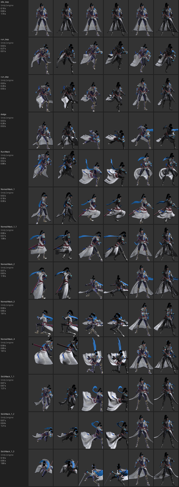
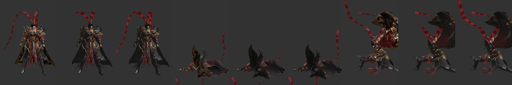
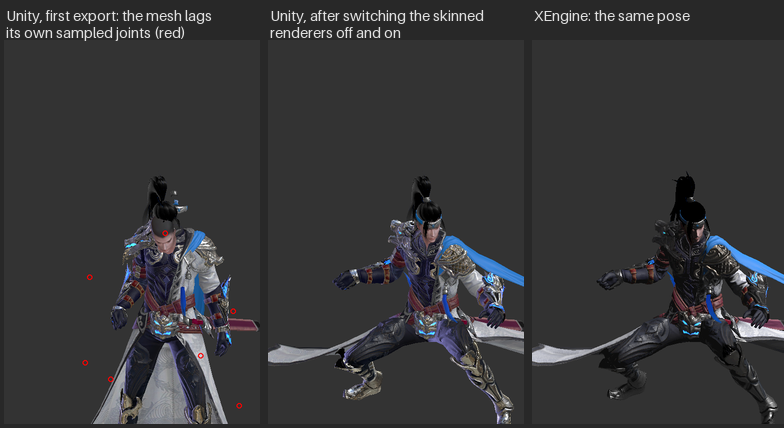

# M2 — 动画（验收）

- 日期：2026-11-26
- 结论：**通过。** 五个角色共 124 条战斗剪辑在引擎里播放出来的骨骼姿态与 Unity 自己采样的一致：
  171,930 个骨骼旋转最大差 0.396°，170,690 个骨骼位置最大差 2.08 mm，根运动位置最大差 18.5 mm；
  渲染出来的画面里角色所在的范围与 Unity 相差不超过 20 像素。Unity 参考帧与引擎帧的并排图在
  [`sheets/`](sheets/)（每个角色两张，每行一条剪辑、三个关键时刻，左 Unity 右引擎）。
- 引擎版本：1.1.0-a19（含引擎 `main` 的 `cfab4988a`、`fcf643108`、`f0f68d5a3`）。



## 运行方式

```powershell
# Unity 侧（jws2 的编辑器打开 F:\jws2\client 并空闲）；每个角色一次
py -3 Tools/unity_export/clip_manifest.py Hero_LvBu                       # 列出要导出的剪辑
py -3 Tools/unity_export/run_export.py run export_clips --filter Hero_LvBu --out Export/clips --timeout-ms 900000
# 引擎侧
py -3 Tools/xengine_live/mcp_live.py --wait-compile 300 --eval-file Tools/xengine_live/evals/generate_clips.cs
XEngine.Editor.exe --refresh-assets --project <root>                       # 导入生成的 .anim / .controller
py -3 Tools/xengine_live/mcp_live.py --wait-compile 300 --eval-file Tools/xengine_live/evals/capture_poses.cs
py -3 Tools/sanguo_import/compare_anim.py --sheets docs/evidence/m2/sheets
py -3 -m pytest Tools -q ; dotnet test SanGuoXEngine.Tests.csproj
```

## 导入结果

| 项 | 数量 | 说明 |
|---|---|---|
| 剪辑 | 124 条（赵云 26、关羽 25、刘备 26、张飞 23、吕布 24） | 清单在 `Tools/unity_export/clip_manifest.py`：待机、跑、闪避、冲刺攻击、普攻、技能、无双、受击、倒地、浮空、眩晕、死亡、胜利、入场、离场。张飞没有 `bighurt`，关羽没有 `NormalAttack_1_1` |
| 控制器 | 5 个 | 每条剪辑一个状态、没有过渡（与原控制器一样由代码点名播放）；每个状态的速度都乘同一个参数 `SpeedMultiplier` |
| 关键帧 | Unity 222 万 → 引擎 224 万 | 108,041 条浮点曲线：59,659 条常量、10,802 条三次曲线、37,580 条逐帧重采样 |
| 体积 | `Assets/Heroes/Animation/` 138 MB 文本 | 曲线以 40 字节 / 关键帧的二进制块再 Base64 存进 Echo 文本；共线关键帧合并只能省 7%，没有做 |
| 事件 | 0 | 原剪辑不带动画事件，音效与特效由数据表驱动（M4–M6） |

导出文档（`Export/clips/Hero_*.json`，不入库）每条剪辑带：全部曲线（时间、值、入 / 出斜率、权重）、
剪辑设置、Unity 在 11 个固定时刻采样的全部节点姿态、以及其中 3 个时刻的参考帧。参考帧用 M1 的相机，
相机跟着角色走（突进类动作会前进几米），角色按「运行时等效位置」摆放（见「根运动」）。

## Unity 怎么播放曲线

把导出的关键帧直接当三次 Hermite 曲线播放，和 Unity 的采样对不上：最大差 14.1°，1% 的采样差 3.2° 以上。
逐条曲线对照 Unity 的采样后确认，Unity 按关键帧密度分两种方式播放一条浮点曲线：

| 曲线 | 条件（实测） | Unity 的播放方式 | 引擎侧的处理 |
|---|---|---|---|
| 常量 | 所有的值相同、斜率为 0 | 保持不变 | 只留一个关键帧 |
| 逐帧（dense） | 关键帧数 × 5 **大于** 剪辑帧数，且关键帧都落在帧时刻上（偏离 ≤ 0.03 帧、相邻关键帧 ≥ 0.5 帧） | 在剪辑的每个帧时刻（30 Hz）求值，帧与帧之间**线性** | `SanguoClipBuilder` 用同一条 Hermite 曲线在帧时刻求值，存成线性关键帧 |
| 稀疏（streamed） | 其余 | 关键帧之间的三次 Hermite（斜率、权重照原样） | 照原样存（斜率换算成引擎的「整段增量」单位） |

三个条件的边界都是量出来的：关键帧数恰好是帧数的五分之一时按 Hermite 播放（14/70、6/30、12/60），
从 0.216 起按逐帧播放；张飞的 `node_fixed` 关键帧落在帧与帧之间（偏离 0.1–0.49 帧），吕布的 `node_fixed`
有相距 0.006 帧的两个关键帧——这两类无论多密都按 Hermite 播放。规则实现在 `SanguoClipBuilder.ConvertCurve`，
单元测试覆盖每条规则。

按这套规则转换后，同样的采样点最大差 0.40°（下表）。剩下的差来自 Unity 把关键帧存成四位小数。

## 根运动

- 原剪辑把根节点 `Bip001` 的位移另存成 Animator 的 `RootT` / `RootQ` 曲线。Unity 运行时按**增量**移动角色
  （角色不会瞬移到曲线的绝对位置），把 `Bip001` 钉在「自己的曲线 − RootT」上；`RootT` 一律按帧求值。
  导出的 RootT 曲线是连续的绝对坐标（连段的第三下从 4.4 m 处开始），所以参考帧里角色要减去起点偏移。
- 引擎侧：RootT / RootQ 写成剪辑的「模型根轨迹」（空路径 + `RootBonePath = "."`），Animator 按增量施加，
  与 Unity 相同；`Bip001` 的位置曲线换成「自身曲线 − RootT」（一个几厘米以内的残差曲线）。
- 实测（吕布 `NormalAttack_1`，走 Animator 自己的根运动代码）：0.5 s 时角色前进 0.9105 m、1.0 s 时
  1.4402 m、结束时 1.9126 m，Unity 的值是 0.9105 / 1.4402 / 1.9126。
- 怎么在玩法里消费根运动（原作把每逻辑帧的位置烘进 `AnimationMove` 表）留给 M4。

## 数值比对

引擎侧在实时编辑器里把每条剪辑从头播放到 Unity 采样过的每个时刻（`SanguoCaptureStudio.CapturePoses`），
读回全部节点的局部变换，`Tools/sanguo_import/compare_anim.py` 与 Unity 的采样逐个比较。

| 角色 | 剪辑 | 骨骼旋转数 | 最大差 | 骨骼位置数 | 最大差 | 根运动位置最大差 | 帧对 | 画面里角色范围最大差 |
|---|---|---|---|---|---|---|---|---|
| 赵云 | 26 | 39,520 | 0.227°（SkillAttack_2 右手手指） | 39,260 | 0.33 mm | 2.0 mm | 76 | 20 px（均值 2.1） |
| 关羽 | 25 | 26,250 | 0.211°（SkillAttack_1_2 袖子骨） | 26,000 | 0.01 mm | 4.8 mm | 73 | 2 px（均值 0.2） |
| 刘备 | 26 | 38,480 | 0.396°（bighurt 右手手指） | 38,220 | 0.01 mm | 18.5 mm（NormalAttack_4 的根） | 78 | 2 px（均值 0.4） |
| 张飞 | 23 | 27,600 | 0.060°（getout 腰带骨） | 27,370 | 2.08 mm（SA_1 肩甲骨） | 0.3 mm | 67 | 5 px（均值 0.8） |
| 吕布 | 24 | 40,080 | 0.348°（knockback 左手手指） | 39,840 | 0.00 mm | 2.5 mm | 70 | 11 px（均值 3.0） |

阈值：旋转 0.5°、骨骼位置 5 mm、根运动位置 30 mm（根运动节点与角色根带着 Unity 按帧取值的残差）、
画面范围 24 px，全部通过。另有 8 对帧两侧都不在画面里（入场 / 离场剪辑的第一帧、赵云 `fly_p7`），
不参与比较。C# 测试 `SanguoClipBuilderTests.ExportedClips_ReproduceUnitySamples` 在不启动编辑器的情况下
把生成的剪辑直接求值再比一遍，数字相同（差 < 0.001°）。明细：[`anim-report.json`](anim-report.json)，
测试输出：[`test-results.txt`](test-results.txt)。

「画面里角色范围」是 Unity 帧与引擎帧里角色所占的外接矩形（上、下、左、右）的差，只看轮廓不看明暗。
引擎帧比 Unity 暗（M1 已记录的着色差异），所以不用重合度当指标。

## 运行时组件 `SanguoAnimator`

`Assets/Scripts/Animation/SanguoAnimator.cs` 是玩法代码点播动画的入口，在实时编辑器里逐项验证过：

| 功能 | 结果 |
|---|---|
| `Play(状态名, 淡入)` | 经控制器播放；控制器里没有的状态返回 `false` |
| `Finished` | 单次剪辑到尾后为 `true`，姿态停在最后一帧（`die`：归一化时间 1，头部朝向与起手不同并保持） |
| `Speed` | 0.5 时 0.3 s 推进 0.09 个剪辑（全速是 0.18），姿态与全速 0.45 s 时相同。走的是控制器状态的速度乘数参数 |
| `InsertHurt(状态名)` | 在加法层上播放（层数 1 → 2），基底动作继续（0.5 s 后基底归一化时间 0.6），下一帧姿态即叠加受击 |
| `ClearHurt(淡出)` | 0.5 s 后受击状态为空 |

与原控制器一致：原控制器第二层 `hurt` 也是加法层、默认权重 0。

## 已知差异（有意或留待后续）

| 项 | 说明 | 去向 |
|---|---|---|
| 受击加法层的合成结果 | 引擎的加法层按「剪辑 − 首帧」叠加；Unity 侧没有合成姿态的采样，没有做数值比对 | M4 做受击时目检 |
| 根运动的玩法消费 | Animator 已按增量移动角色；逻辑怎么用它（原作烘表）未定 | M4 |
| 刘备 NormalAttack_4 的根 | 0.07 s 时与 Unity 差 18.5 mm，是 Unity 按帧取值的残差 | 记录 |
| 剪辑体积 | 138 MB 文本 | 如需再压，可减少常量曲线或改存储格式 |
| 播放模式下的验证 | 编辑器模式下 `CapturePoses` 手动步进 Animator（`Update` + 引擎的根运动提取）；`LateUpdate` 的完整路径在玩法里跑 | M4 |
| 着色 | 引擎帧比 Unity 的游戏着色器暗（无边缘光、假皮肤、IBL），与 M1 相同 | M8 |

## 头发改为双面（顺带修正 M1）

并排图一出来就看到吕布头盔左侧的长翎在引擎里大多不见。原因是头发网格是单面的发片，Unity 的头发着色器
画三遍（不透明的正面、透明的背面、透明的正面），引擎用 `Default/StandardAnisotropic` 代替时沿用了着色器的
默认值（剔除背面），从背面看的发片全部消失。M1 记成「短一截」的就是这个。现在头发材质显式设 `_Cull = 0`
（`Tools/sanguo_import/material_mapping.py`，双面、不透明、alpha 测试），吕布的帧范围差从最大 124 px
降到 11 px。M1 的截图与数值已按此重拍（吕布亮度 0.105 → 0.107，其余角色不变）。



## 工具性发现

- **Unity 在编辑模式下渲染蒙皮网格会滞后。** 采样之后立刻 `camera.Render()`，画出来的往往是上一次的蒙皮：
  快速动作（跑、闪避、连击）的参考帧里，关节投影落在角色身体之外几十像素，而采样到的变换本身是对的。
  渲染前把每个 `SkinnedMeshRenderer` 关一下再开，才画出当前姿态（`BakeMesh`、连渲两次、`Rebind`、
  `updateWhenOffscreen` 都无效）。验证办法：把采样的关节投影到图上看是否落在身体上。

  

- **编辑器模式下 Animator 不会自己绑定控制器。** 运行时的 `LateUpdate` 负责延迟绑定，编辑模式里没有这一步：
  要先 `SetControllerAsset`（阻塞到剪辑就绪），之后 `HasState` / `CrossFade` 才有效；先查 `HasState` 会得到 `false`。
- **`Animator.Update(dt)` 不施加根运动**（它是给检视器预览用的）。施加根运动的是 `LateUpdate` 末尾的
  `ExtractRootMotion`，编辑模式下截图要自己调它。
- **控制器状态的速度每帧由运行时写回**（状态速度 × 乘数参数），直接改 playable 的 `Speed` 或 `Animator.Speed`
  都不生效；要用状态的速度乘数参数。
- **AIBridge 的占位符是全文替换**：脚本里不要再写 `"__NAME_FILTER__"` 这类字面量做检查，它也会被替换掉。
  正则里的反斜杠在生成的代码里会被吃掉，脚本里不用正则。
- `AnimationCurve` 在 `XEngine.Runtime` 和 `XEngine.Vector` 里各有一个，同时 `using` 两个命名空间时要起别名；
  引擎切线的单位是「整段的增量」，Unity 的斜率是「每秒」，转换时乘以段长。`new AnimationCurve()` 会带两个
  默认关键帧并重算切线，要先 `Keys.Clear()`。
- `new[]` / `new("…")` 这类目标类型 new 在这两个工程里编译不过（跟随成员访问时），写全类型名。

## 测试

- Python：`py -3 -m pytest Tools -q` → **90 通过**（M1 的 70 个 + 剪辑清单 10 个 + 动画比对 9 个，其中含头发双面 1 个）。
- C#：`dotnet test SanGuoXEngine.Tests.csproj` → **22 通过**（曲线规则 8、整段剪辑 5、对 Unity 采样的数值验收 1、M1 的 8 个）。
