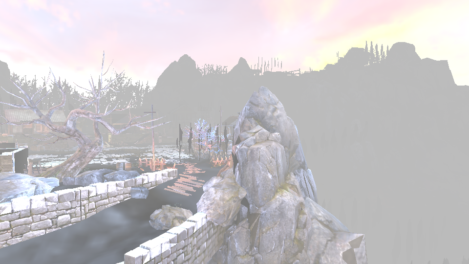
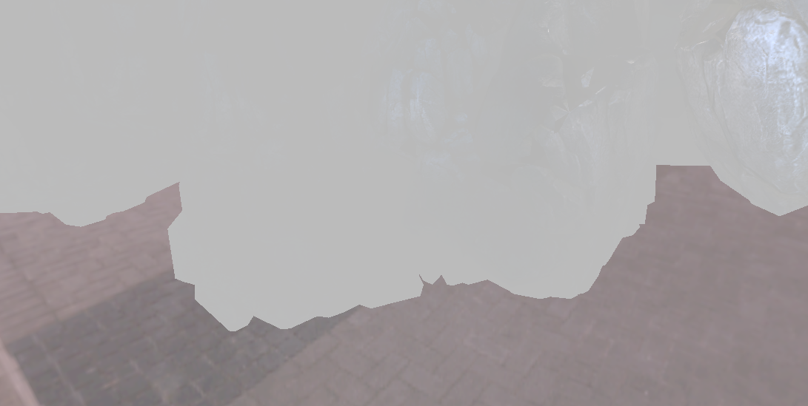

# B0 桃园 Demo 性能基线

日期：2026-11-27

## 环境

- 编辑器：`D:/Engine/XEngine/Build/Editor/Debug/net10.0/XEngine.Editor.exe`
- 工程：`SanGuoXEngine`
- 后端：D3D12
- 目标窗口：编辑器 GameView
- 场景：`Scenes/TaoYuan.scene`、`Scenes/TaoYuanBattle.scene`
- 当前子模块提交：`1496b49`

## 已通过测试

- Python：`py -3 -m pytest Tools -q`，108 passed
- C#：`dotnet test SanGuoXEngine.Tests.csproj --no-restore`，45 passed

## 场景快照

`scene_quickshot.cs` 在固定桃园 close 机位完成一次离线渲染。全部 3140 个材质引用已调用 `EnsureLoaded()`。



当前快照显示远景和中景明显过曝，场景结构可见，粒子和部分远景内容缺失。

## 战斗 Play 快照

使用 `enter_battle_play.cs` 打开 `TaoYuanBattle.scene`，打开 GameView，进入 Play，等待 8 秒后读取 `RenderStats.Last` 并抓取 GameView。

原始统计：

```text
draw=3097
inst=0
tris=4160890
shadow=11568
lod=847
```



当前战斗快照显示相机主体仍然过曝，英雄和敌人没有形成可用的角色画面。`inst=0` 证明当前战斗场景没有使用 GPU Instancing。

## 当前判定

- B0 基线采集路径可重复运行。
- 当前引擎统计已能区分普通 draw call 和 GPU Instancing draw call。
- 静态场景仍按独立 `MeshRenderable` 收集，静态标记尚未进入自动静态批处理。
- 战斗敌人仍使用独立占位对象，未进入真实模型和实例化路径。
- B1 进入引擎静态批处理注册表和 `GameObject.IsStatic` 接入。
