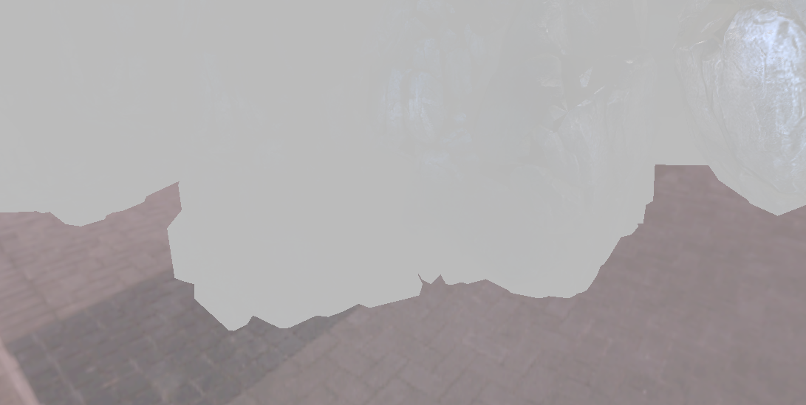

# B1 静态场景自动实例批处理

日期：2026-11-27

引擎提交：`9be3027e8`

## 实现结果

引擎将 `GameObject.IsStatic` 对象按 Mesh、Material、Shader Pass 和 per-renderer 批次属性分组，自动提升为 `InstancedMeshRenderable`。`_ObjectID` 不影响批次哈希，光照贴图和材质状态仍然参与分组。

## 编辑器 Play 验收

后端：D3D12

场景：`Scenes/TaoYuanBattle.scene`

等待 Play 8 秒后的统计：

```text
draw=2818
inst=56
staticGroups=196
staticInstances=1515
tris=4160890
shadow=10528
lod=847
```

B0 基线：

```text
draw=3097
inst=0
tris=4160890
shadow=11568
lod=847
```

静态批处理减少 279 个颜色 draw call，并产生 56 个 GPU Instancing draw。静态批次覆盖 1515 个场景实例。



当前画面仍保留已有白化和角色取景问题，后续视觉节点继续处理。
