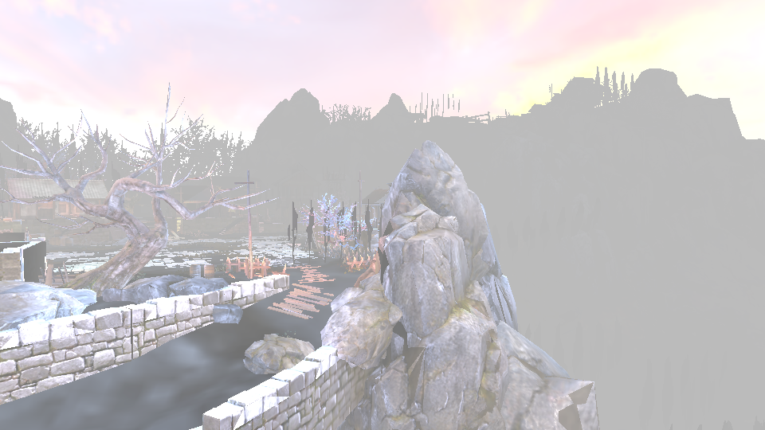

# B3 桃园场景接入验收

日期：2026-11-27

## 实现

- 完整桃园场景写入 `TaoYuan.scene` 和 `TaoYuanBattle.scene`。
- 场景生成器保留 `GameObject.IsStatic`、LODGroup、LightmapIndex、LightmapScaleOffset、材质和 Rendering Layer 数据。
- 场景相机使用 HDR 和 4000 远裁剪面，Layer 31 碰撞代理从 GameView 排除。
- 场景资产已进入静态批处理、动态合批和 LOD 路径。

## 场景证据

- 场景对象：4046
- LODGroup：1378
- 光照贴图：2 页
- D3D12 战斗帧静态批次实例：1515
- D3D12 战斗帧动态批次实例：3914

## 边界

SpeedTree `.asset` 网格、粒子和部分 Effects 材质仍列入 B6 视觉资产补齐范围。当前证据确认完整桃园层级、静态标志、LOD 和光照贴图引用已进入编辑器运行时。
