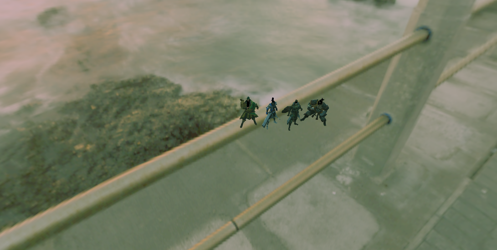
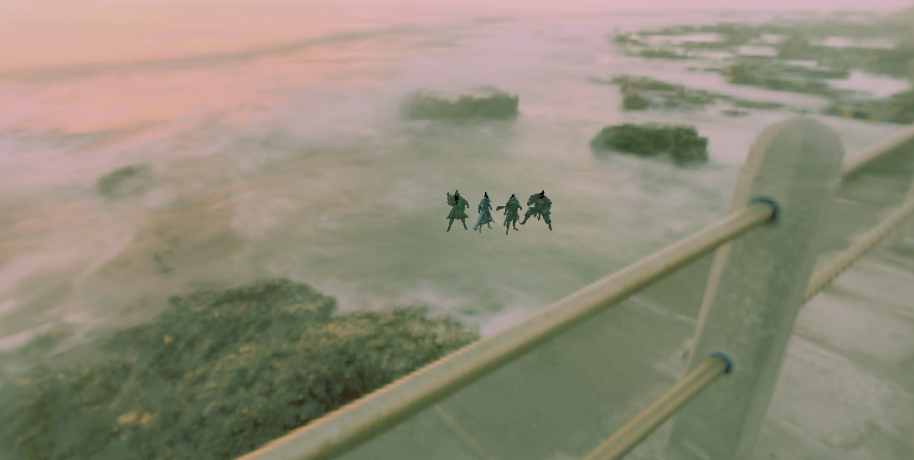

# B4 角色和敌人接入验收

日期：2026-11-27

## 实现

- 四名英雄继续使用已验收的真实英雄 Prefab。
- 战斗敌人从立方体占位体切换到已导入的 `xiaobingyuanjing` 真实士兵模型 Prefab，GUID 为 `e4251061-3dcd-e554-cc2f-6348e0f66f65`。
- 敌人模型实例继续绑定 `SanguoActorPresenter`，保留移动、受击和死亡逻辑。
- 只有模型导入失败时才回退到内置立方体，避免场景启动失败。

## D3D12 Play 证据

英雄跟随镜头：

敌人聚焦镜头：

敌人聚焦帧的运行统计：

- `drawCalls=1424`
- `instancedDrawCalls=40`
- `triangles=3,870,556`
- `shadowDrawCalls=7,418`
- `imageEffects=4`
- `backendName=Direct3D 12`

## 当前边界

原始 YellowArmy 角色包没有随当前子模块提供，当前使用已存在的黄巾士兵远景模型作为真实模型接入验证。逐 MonsterID 的 YellowArmy、EliteMageArmy、骑兵 Prefab 映射和 GPU 蒙皮实例组仍待后续资产节点处理。
