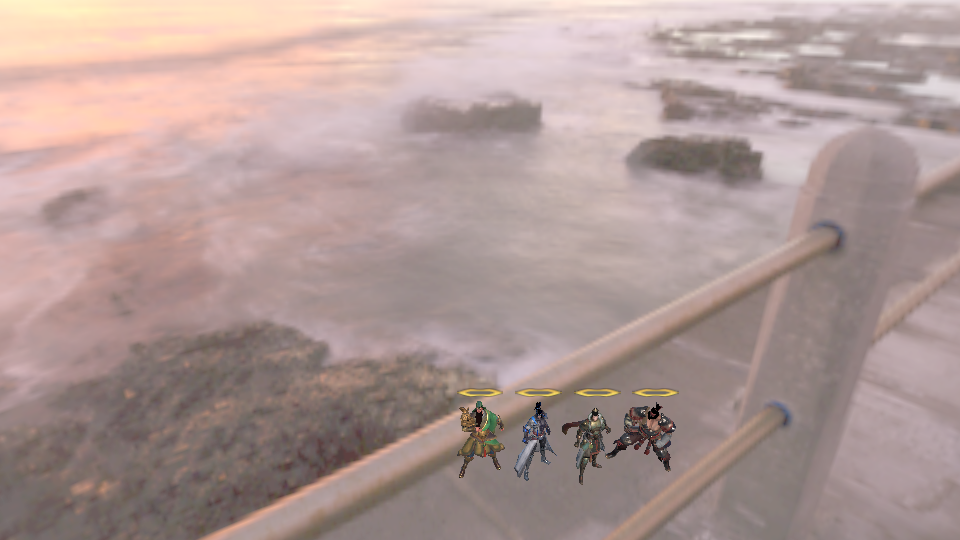

# B4b 怪物模型数据映射

日期：2026-11-27

战斗驱动器读取 `SanguoMonsters.asset` 的 `MonsterID → ModelID`，再查 `SanguoMonsterModels.asset` 的 `ModelScale` 和 `DmgNumHeight`。可见敌人 prefab 现在使用导入表中的模型缩放，Hudmesh 血条和伤害数字锚点使用对应的 `DmgNumHeight`，缺失数据使用演示默认值。

验证结果：

- `dotnet build SanGuoXEngine.Game.csproj -c Debug --no-restore` 通过
- `dotnet test SanGuoXEngine.Tests.csproj -c Debug --no-restore` 46/46 通过
- D3D12 编辑器 Play，1280×720 GameView
- `drawCalls=29`、`instancedDrawCalls=1`、`triangles=104,864`
- 截图显示真实英雄、真实黄巾远景模型和战斗 HUD

原始 YellowArmy、EliteMageArmy 和骑兵 prefab 尚未全部进入当前子模块资产树，逐 MonsterID prefab 替换仍是后续资产节点。
