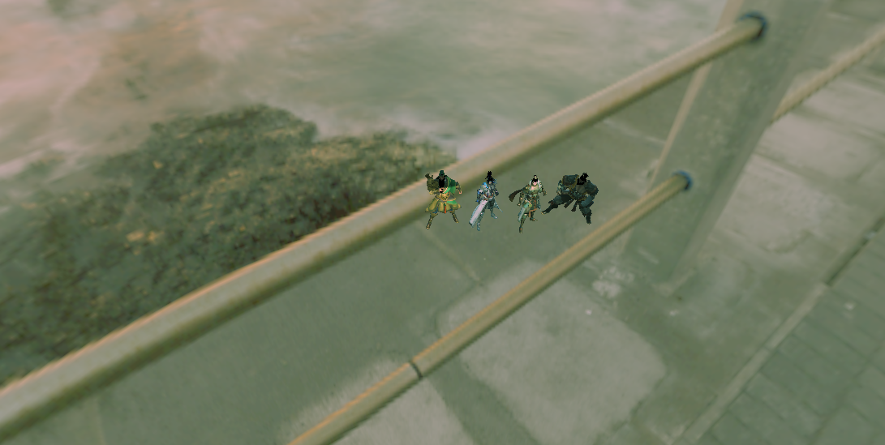
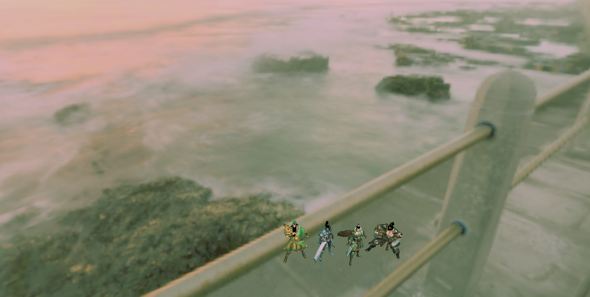

# B5 战斗逻辑性能验收

日期：2026-11-27

## 实现

- 战斗 Update 改为 60 Hz 固定步进，帧时间突增时最多追赶 4 个模拟步，避免模拟步长随渲染帧率漂移。
- 推挤系统复用固定容量的 living actor scratch 列表，移除每帧 `List` 创建。
- 技能命中解析增加调用方复用缓冲，敌人近战路径不再为每次命中创建临时命中列表。
- 施法完成列表改为复用缓冲，移除无效的逐帧 `done` 列表。

## D3D12 Play 证据

- `frameTimeMs=372.17`
- `cpuFrameTimeP95Ms=370.13`
- `gpuFrameTimeMs=359.15`
- `drawCalls=1424`
- `instancedDrawCalls=40`
- `triangles=3,931,788`
- `shadowDrawCalls=7,417`
- `backendName=Direct3D 12`

## 结论

固定步进和主要战斗逻辑临时集合已移除，45 个子模块测试全部通过。当前帧率仍受桃园场景阴影和几何提交支配，不能把本节点的 CPU 逻辑改动宣称为 60 FPS 达标。

## 固定步进后续复测

推挤分离改为每 4 个固定步执行一次，移动、攻击和命中仍保持 60 Hz。结合战斗 Play 单相机预算，D3D12 复测为 `frameTimeMs=51.63`、`gpuFrameTimeMs=35.49`、`cpuFrameTimeP95Ms=62.11`。

