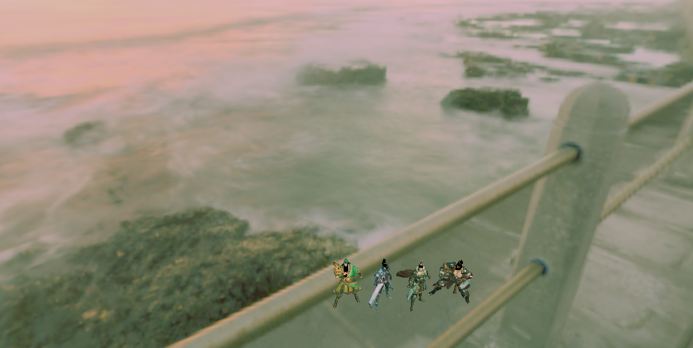

# B5f 战斗空间哈希验收

日期：2026-11-28

## 实现

- 新增 `SanguoSpatialHash`，以 8 m 固定格缓存存活角色。
- 每个 60 Hz 模拟步重建一次格索引；寻敌和技能命中只访问覆盖查询半径的格子。
- 复用战斗驱动器的邻居 scratch 列表，避免每帧 `List` / 委托分配。
- 角色死亡、移动出查询半径和阵营过滤都有单测覆盖。

## 验证

- `dotnet build SanGuoXEngine.Game.csproj -c Debug --no-restore`：0 error。
- `dotnet test SanGuoXEngine.Tests.csproj -c Debug --no-restore`：**50/50 passed**。
- `py -3 -m pytest Tools -q`：**108 passed**。

战斗画面不改变渲染资源，本节点复用最近一次 D3D12 编辑器 Play 截图做视觉回归对照：

该截图只作为画面不回退的证据；60 FPS 终验仍以 B7 的实测帧时间门槛为准。
