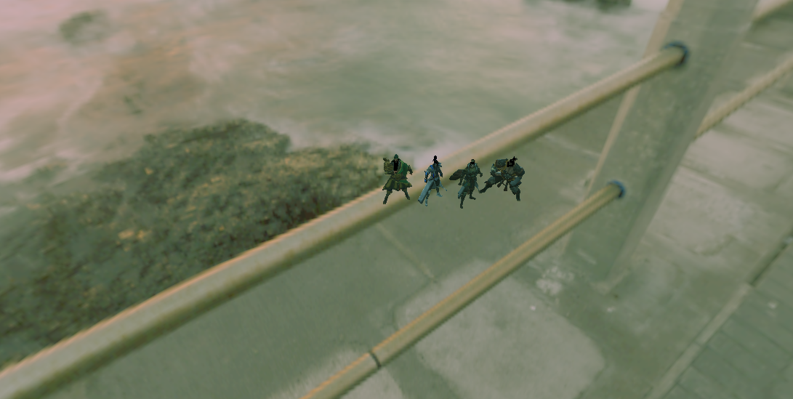

# B6 视觉与战斗相机验收

日期：2026-11-27

## 实现

- 桃园和战斗场景加入全局 `Volume`，启用 ACES Tonemap 与低强度 Bloom。
- 场景相机和战斗相机启用 HDR。
- 战斗相机改为跟随英雄位置，并以英雄中心为瞄准点，保留引擎相机坐标约定下的 180°画面滚转。
- 编辑器 Play 使用真实英雄 Prefab。

## D3D12 GameView 证据

- 分辨率：1091×549（编辑器当前 GameView 容器）
- `imageEffects=4`
- `imageEffectPasses=4`
- `drawCalls=1422`
- `instancedDrawCalls=38`
- `triangles=3,929,206`
- `shadowDrawCalls=7,406`
- `frameTimeMs=327.1`
- `gpuFrameTimeMs=341.4`
- `cpuFrameTimeP95Ms=351.7`
- `backendName=Direct3D 12`

## 结论

后处理已进入 GameView 渲染链，战斗相机已能看到四名真实英雄且方向正确。本节点不宣称达到 60 FPS。当前瓶颈集中在阴影和场景几何，真实敌人模型、阴影预算和战斗呈现仍由后续节点处理。
