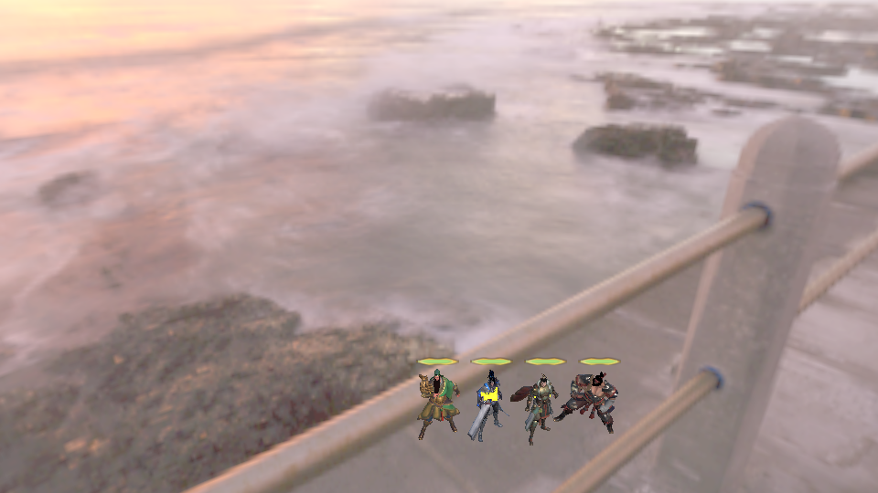

# B6b 命中粒子

日期：2026-11-27

战斗驱动器增加一个共享的 GPU 实例粒子系统，用于英雄和敌人命中反馈。粒子系统使用 `Default/Particle`、世界空间、短生命周期和预分配容量，命中时移动发射器并调用 `Emit(6)`。HUD 血条和命中粒子共用战斗帧验证。

验证结果：

- `dotnet build SanGuoXEngine.Game.csproj -c Debug --no-restore` 通过
- `dotnet test SanGuoXEngine.Tests.csproj -c Debug --no-restore` 46/46 通过
- D3D12 编辑器 Play，1280×720 GameView
- `drawCalls=30`、`instancedDrawCalls=3`、`triangles=105,572`
- 截图可见英雄、血条和命中粒子反馈

完整 42 个 Unity Effect 材质和技能特效映射仍待 M5 资产节点继续接入。
