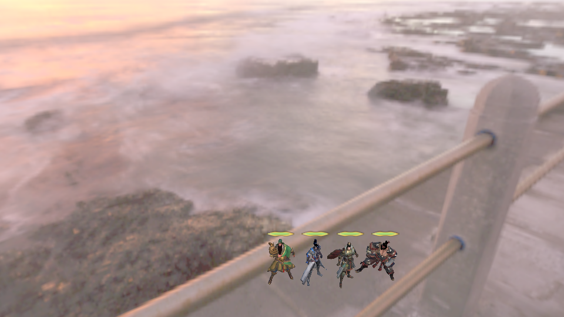

# B6a 战斗 HUD

日期：2026-11-27

战斗场景接入 `com.xengine.hudmesh`。可见英雄和敌人会创建世界空间血条，血量变化实时更新，命中时调用浮动伤害数字。编辑器预览使用 bundled HUD sprite，并将默认血条缩小到 120×24 像素以避免四名英雄互相覆盖。

验证结果：

- `dotnet build SanGuoXEngine.Game.csproj -c Debug --no-restore` 通过
- `dotnet test SanGuoXEngine.Tests.csproj -c Debug --no-restore` 46/46 通过
- D3D12 编辑器 Play，1280×720 GameView
- `drawCalls=29`、`instancedDrawCalls=1`、`triangles=104,864`
- 截图可见四名英雄头顶血条和桃园桥场景

该截图在战斗暖机阶段采集，伤害数字由命中回调驱动，持续时间由 Hudmesh 默认曲线控制。
