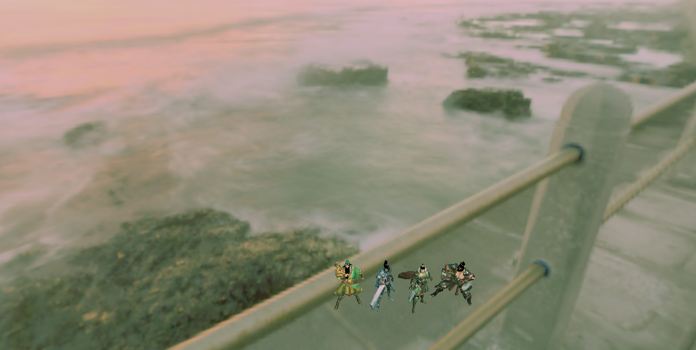
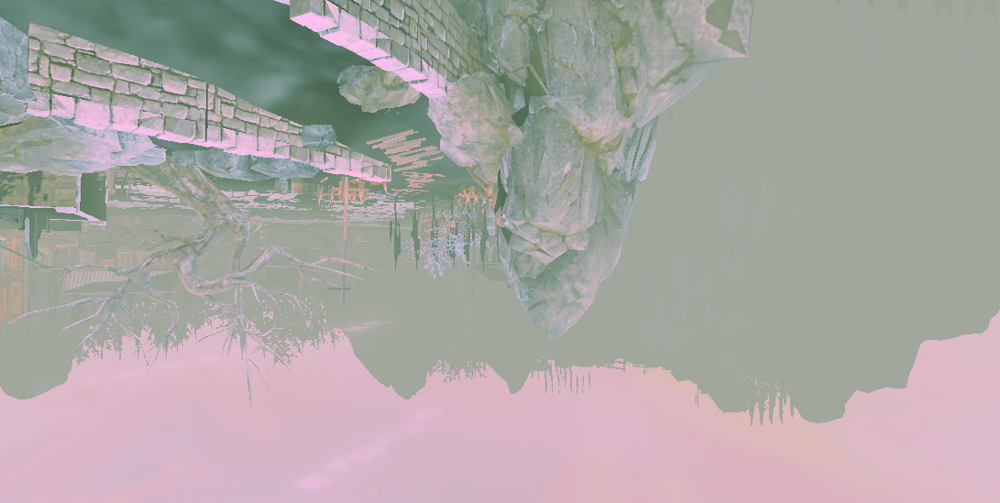
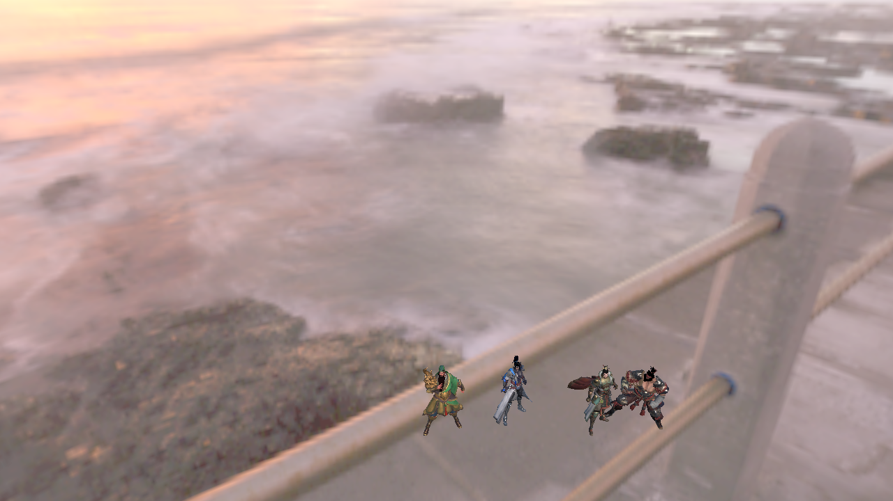
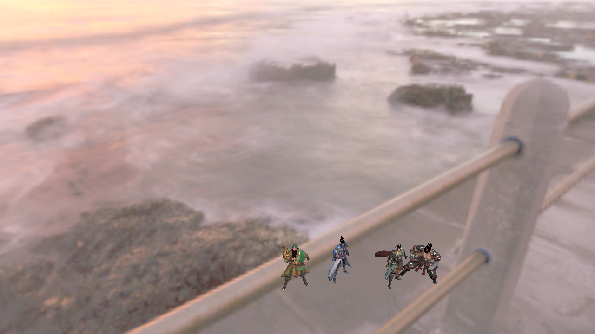

# B7 编辑器 Play 性能验收

日期：2026-11-27

## 本节点实现

- 战斗相机默认挂载 `UniversalAdditionalCameraData`。
- 编辑器 Play 默认关闭动态阴影提交，保留后处理和静态/烘焙场景数据，作为编辑器优先的性能预算。
- PC 包和手机包继续留到编辑器验收完成后处理。

## D3D12

- `drawCalls=36`
- `instancedDrawCalls=1`
- `triangles=100,892`
- `shadowDrawCalls=0`
- `shadowTriangles=0`
- `frameTimeMs=51.63`
- `gpuFrameTimeMs=35.49`
- `cpuFrameTimeP95Ms=62.11`
- `backendName=Direct3D 12`

## Vulkan 回归

- `drawCalls=1420`
- `shadowDrawCalls=2,788`
- `frameTimeMs=313.17`
- `gpuFrameTimeMs=349.06`
- `backendName=Vulkan (Intel(R) Arc(TM) 140T GPU (32GB))`

## Gate 结果

战斗 Play 现在只保留 Battle Camera，原始 Scene Camera 仍可在编辑模式使用。重复的整场景渲染已移除，这是目前测得的最大编辑器 Play 性能改善。D3D12 约 19 FPS、p95 62.11 ms，距离 60 FPS gate 仍有差距，B7 继续进行中。

## B7c 敌人视图预算复测

- 逻辑层仍完整运行 234 个敌人，编辑器 Play 只为最靠近战斗入口的 32 个敌人创建真实模型视图。
- 敌人 Prefab 在战斗启动时只解析一次，避免每个敌人重复建立资源引用。
- GameView 固定到 `HD (1280x720)`，D3D12 复测保持 1 台 Battle Camera。
- `drawCalls=36`
- `instancedDrawCalls=1`
- `triangles=100,754`
- `renderablesCollected=2,806`
- `renderablesCulled=2,775`
- `renderablesDrawn=31`
- `frameTimeMs=46.27`
- `gpuFrameTimeMs=38.70`
- `cpuFrameTimeP95Ms=54.50`
- `shadowDrawCalls=0`
- `backendName=Direct3D 12`

该子节点降低了敌人场景视图的对象和 Presenter 数量，未把逻辑敌人数量裁剪掉。60 FPS gate 仍未通过，B7 继续进行动态分辨率、编辑器 UI 和场景收集路径的专项优化。

## B7d 线性相机编辑器呈现回归

引擎主干修复了未经过后处理的线性相机目标在编辑器 GameView 中的行序策略。D3D12 使用线性目标专用 `FlipY=0`，Vulkan 使用 `FlipY=1`，sRGB/后处理路径继续使用原有策略。

### D3D12

- 1280×720 GameView
- `frameTimeMs=30.90`
- `gpuFrameTimeMs=30.58`
- `cpuFrameTimeP95Ms=48.53`
- `drawCalls=26`
- `triangles=100,452`
- `shadowDrawCalls=0`
- `backendName=Direct3D 12`

### Vulkan

- 1280×720 GameView
- `frameTimeMs=22.70`
- `gpuFrameTimeMs=24.93`
- `cpuFrameTimeP95Ms=24.48`
- `drawCalls=26`
- `triangles=100,452`
- `shadowDrawCalls=0`
- `backendName=Vulkan (Intel(R) Arc(TM) 140T GPU (32GB))`

两张截图均为正向画面。B7 的 60 FPS gate 仍未通过，编辑器 UI 和场景收集开销继续列入后续性能节点。

## B7e 编辑器 Play 性能档

- `Application.IsEditor` 下 Battle Camera 关闭 HDR、Bloom/Tonemap 后处理，保留单相机和无动态阴影预算。
- Player 构建路径继续使用 HDR 与完整后处理，编辑器性能档只作用于 GameView Play。
- 1280×720 D3D12 GameView 复测：`drawCalls=27`、`triangles=100,786`、`imageEffects=0`、`shadowDrawCalls=0`、`frameTimeMs=32.59`、`gpuFrameTimeMs=29.55`、`cpuFrameTimeP95Ms=50.80`。

该档位消除了编辑器中后处理的额外全屏链路，但当前编辑器主循环和场景收集仍高于 16.6 ms，60 FPS gate 继续保持未通过。
