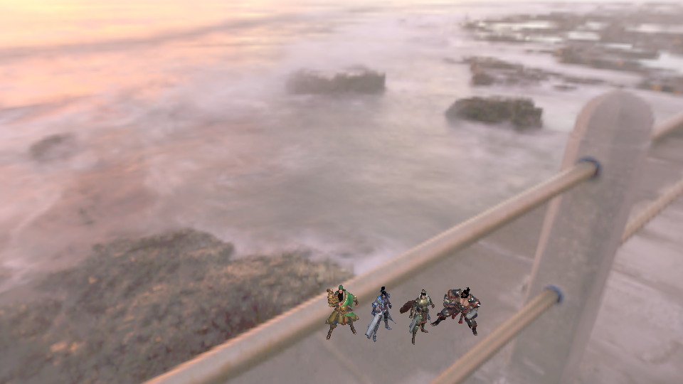

# B7f 静态场景收集缓存

日期：2026-11-27

## 本节点

静态 `MeshRenderer` 在场景组件注册表中进入独立的静态收集通道。AssetRef 解析、PropertyState、MeshRenderable 代理和光照属性在第一次收集后复用。Mesh、材质引用、Transform 版本、Lightmap、纹理覆盖和 Static 开关变化会触发重建。动态 MeshRenderer 仍走普通收集通道。

## 测试

- `dotnet test XEngine.Runtime.Test/XEngine.Runtime.Test.csproj -c Debug --no-restore --filter FullyQualifiedName~StaticBatchingTests`
- 4/4 通过
- `dotnet build XEngine.Editor/XEngine.Editor.csproj -c Debug --no-restore`
- 通过

## 编辑器验收

D3D12、TaoYuanBattle Play、等待 8 秒、960×540 战斗帧。静态缓存计数为 `cacheHits=1814`、`cacheBuilds=63`。

- `frameTimeMs=33.18`
- `cpuFrameTimeP95Ms=55.38`
- `gpuFrameTimeMs=32.09`
- `drawCalls=27`
- `instancedDrawCalls=1`
- `triangles=100,762`
- `renderablesCollected=2,806`
- `renderablesDrawn=44`
- `shadowDrawCalls=0`

本节点截图显示四名英雄和桃园桥场景，60 FPS gate 仍未通过。编辑器主循环剩余帧时间继续单独优化。
